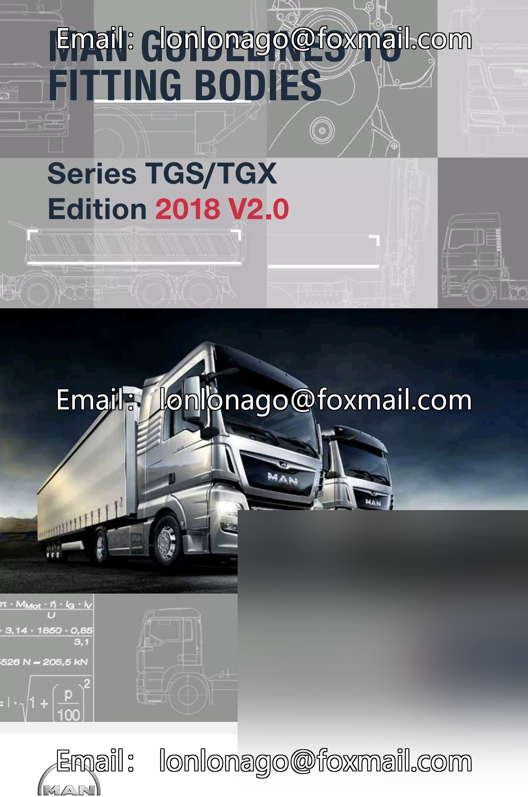
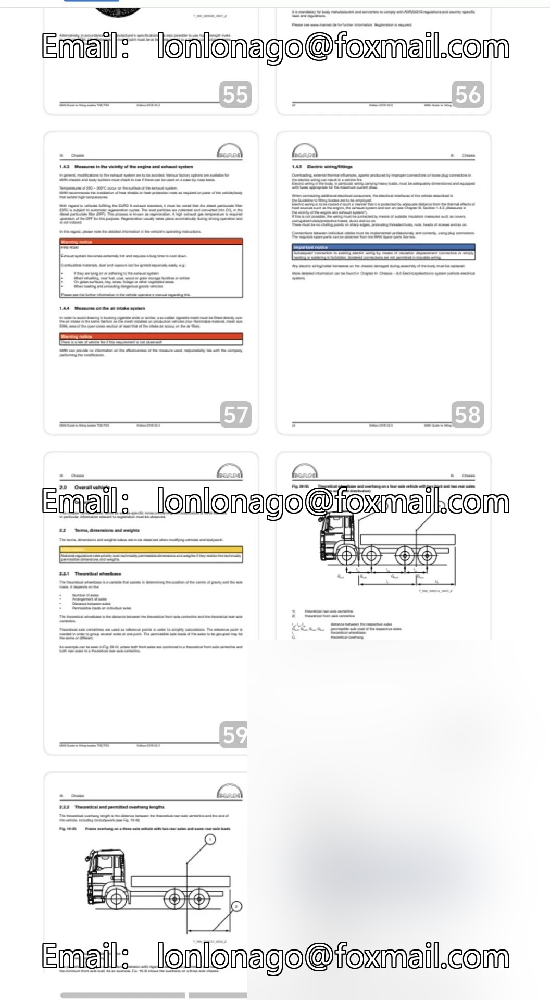
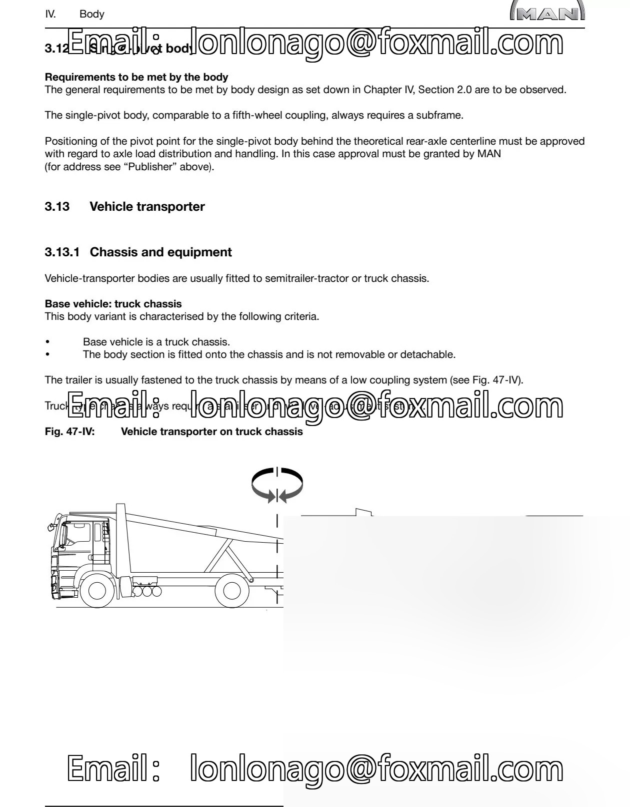

# Man TGS/TGX 2018 Edition Technical Manual 370 pages

## Body

MAN TGS/TGX 2018 Edition Technical Manual, 370 pages
1. Content
1. Core parameters such as vehicle structure, power system, chassis, body, tires, compartment, etc.
2. Assembly, maintenance, and operation processes
3. Standards for vehicle transportation, safety, and environmental protection
2. File format
PDF , complete content, suitable for vehicle maintenance, modification, transportation, and policy reference
3. Data sources
Original factory official documents, professional
4. Non-refundable upon sale
Requires immediate purchase, contact privately for any issues

This manual provides MAN TGS/TGX 2018 edition content, covering vehicle structure, power systems, chassis, body, tires, cab boxes parameters, assembly/maintenance and operation processes; the document is PDF format with complete content, suitable for vehicle maintenance, modification, transport and policy reference.

<!-- AI_ENRICHED -->

## Images

## Payment

Here is a pay link on Stripe ( https://buy.stripe.com/3cs8yP7sY87d0vu9AB ). Please contact me lonlonago@foxmail.com after funding $89, and I will send you a complete data files , thank you!

